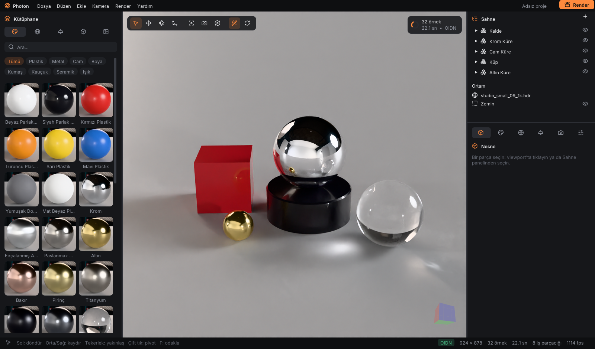
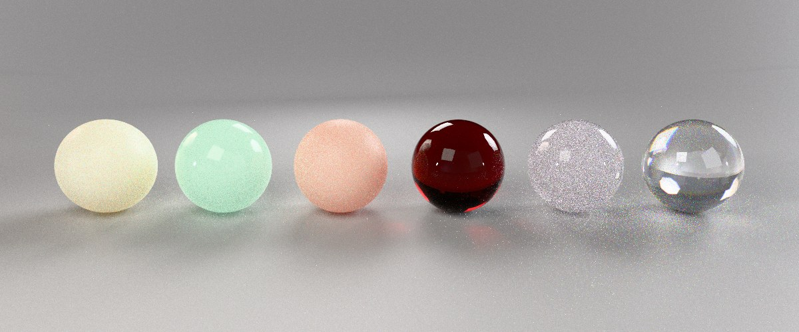
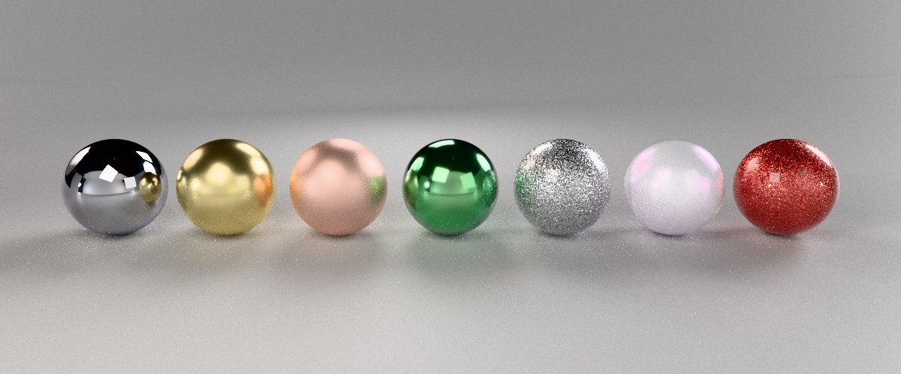
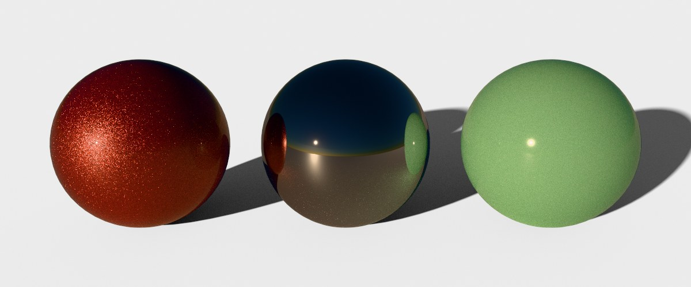
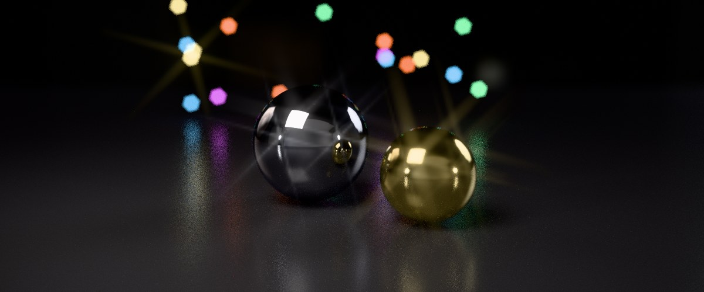
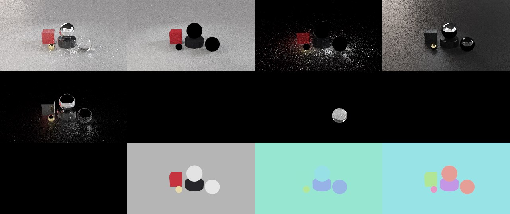

# PhotonEngine

**Ürün görselleştirme için fiziksel tabanlı render motoru ve masaüstü stüdyo.**

PhotonEngine, KeyShot / Octane tarzı bir iş akışı sunan C++20 bir yol izleyicidir (path tracer):
modeli sürükle-bırak ile içe aktar, kütüphaneden malzemeleri parçaların üzerine bırak,
bir stüdyo/HDRI seç, viewport'ta birkaç saniyede gürültüsüz önizlemeyi gör ve tek tıkla
yüksek çözünürlüklü render al. Aynı zamanda bir öğrenme projesidir: kod, bilgisayar
grafiğinin tüm hattını öğretecek biçimde Türkçe açıklamalarla yazılmıştır.



---

## Öne çıkanlar




**Işık taşıma**
- Çok sekmeli yol izleme: ışık örneklemesi (NEE) + BSDF örneklemesi, MIS (güç sezgiseli), Rus ruleti.
- **Işık BVH'si (çok ışıklı sahneler):** her yayıcı üçgen ayrı ışıktır; güç + yön konisi sınırlarıyla
  kurulan ağaçta noktaya göre önemle inilir (PBRT-v4 / Conty–Kulla). 2000 üçgenli LED şeritte
  eşit örnekte gürültü düzgün seçime göre **2.9× düşük**. Az ışıkta (≤ 33) tam tarama.
  Softbox'lar **küresel dikdörtgen** olarak katı açıda düzgün örneklenir (Ureña 2013).
- **HDRI'da MIS telafisi** (Karlík 2019): ışık örnekleri haritanın ortalamanın üstündeki kısmına
  gider; HDRI içinde güneş olan gökte gürültü **6.8×**, stüdyo HDRI'larında %12–33 düşer.
- **Ölçekten bağımsız, kendi kendini gölgelemeyen ışın başlangıcı:** kesişim hata sınırlarıyla
  (PBRT-v4 pError) ofset, tMin = 0; düşük poligonlu yumuşak modellerde **gölge terminatörü**
  düzeltmesi (Hanika 2021). Aynı sahne 0.01× ve 10000× ölçekte aynı görüntüyü verir.
- **Katılımcı ortamlar:** renkli cam ve sıvılarda Beer–Lambert soğurması, bulanık sıvılarda saçılma
  (spektral MIS serbest uçuş, Henyey–Greenstein), iç içe hacimler için ortam yığını.
- **Rastgele yürüyüş yüzey altı saçılımı (SSS)** (Chiang 2016 / Cycles): mum, yeşim, ten, sabun, süt, mermer.
- **Spektral dispersiyon:** Abbe sayısından Cauchy n(λ); yol ilk dispersiyonlu camda bir dalga boyu
  seçer (önem örneklemeli, beyaza normalize CIE ağırlıkları). Elmas "ateşi", prizma gökkuşağı.
- **İnce duvarlı cam:** pencere, ampul, sabun köpüğü; gölgeler renkli ve kostik gürültüsüz geçer, MIS tutarlı.
- **Uyarlamalı örnekleme** (piksel başına göreli standart hata eşiği) ve isteğe bağlı **dolaylı parlama sınırı**.
- Owen karıştırmalı Sobol örnekleme (Burley 2020), Intel Embree 4, Intel Open Image Denoise 2.5.

**Malzemeler**
- Disney Principled + üretim eklemeleri: **enerji korunan katmanlama** (Kulla–Conty albedo ölçekleme:
  vernik → sheen → speküler → difüz; beyaz plastik fırın testinde her açıda ≈ 1.00, önceden 1.58),
  **EON difüz** (enerji korunan Oren–Nayar, Portsmouth 2025; "difüz pürüzlülüğü": kil, kumaş,
  beton), **Charlie sheen** (kadife, albedo tablosuyla normalize), **çoklu saçılma enerji telafisi** (Turquin 2019; beyaz pürüzlü
  metal her pürüzlülükte ≈ %100 yansıtır), **F82 kenar tonu** (ölçülmüş n, k'den metaller), **ince film
  girişimi** (Airy; ısıl renkli titanyum, sedef, yağ tabakası), **metalik boya pulları** (Voronoi),
  vernik, anizotropi, sheen, ince yüzey geçirgenliği, ışık yayma.
- **Yuvarlatılmış kenarlar** (KeyShot "round edges"): keskin CAD kenarları gölgelendirmede yuvarlanır.
- Cam: kusursuz / buzlu (GGX, VNDF), hacim rengi, bulanıklık, dispersiyon, ince duvar + film.
- 60+ hazır malzeme: plastik, ölçülmüş metaller (krom, alüminyum, altın, bakır, gümüş, platin...),
  cam ve sıvılar (şarap, bal, opal, kurşun kristal, elmas, sabun köpüğü), pullu araç boyaları,
  yarı saydamlar (SSS), kumaş, kauçuk, seramik, ışık.

**Aydınlatma**
- HDRI ortamlar (Poly Haven, CC0) + prosedürel stüdyo gradyanları.
- **Fiziksel gök + güneş** (Nishita: Rayleigh, Mie, ozon): yükseklik/yön ya da **konum + tarih + saat**
  (NOAA), pus, güneş boyutu; güneş ortam ışığının içinde ayrı bir koni olarak örneklenir (keskin, temiz gölge).
- Alan (softbox, **kameraya görünmez** seçeneği), güneş, nokta ve **spot ışıklar (IES profilleriyle)**.
- **Gölge yakalayıcı zemin:** ürünü beyaz fona ya da şeffaf PNG'ye yalnız gölgesiyle yerleştirir.
- Arka plan: ortam, düz renk ya da şeffaf (alfa kanallı PNG). 6 stüdyo preset'i.



**Kamera ve görüntü**
- Fiziksel kamera: odak uzaklığı, f-durağı, alan derinliği, **çokgen diyafram (bokeh kanatları)**.
- **Piksel filtresi:** kutu, üçgen, Gauss, Blackman-Harris (filtre önem örneklemesi; ağırlık 1,
  halkalanma yok). Kenarlarda merdivenlenme ve moiré azalır.
- **Görüntüleyici (imager):** bloom, yıldız parlaması (glare), beyaz dengesi (K + ton), kontrast,
  doygunluk, vinyet, renk sapması; viewport ve son render'da (EXR ham kalır).
- Ton eşleme: **Khronos PBR Nötr** (ürün renkleri için), AgX, ACES, Hable; EV pozlama; sRGB + titreşimli 8-bit.



**Render geçişleri (compositing)**
- Tek **çok katmanlı EXR** (Nuke / Blender / Fusion kanal adları): difüz / parlak / geçirgen ×
  doğrudan / dolaylı, emisyon, ortam; derinlik (Z), konum, normal, albedo, nesne ve malzeme kimliği,
  alfa. Işık geçişlerinin toplamı her pikselde beauty'ye eşittir (test 1e-4).



**Diğer 3B uygulamalarla çalışma**
- **FBX** (Maya, 3ds Max, Blender, Cinema 4D vb.; ufbx): birim ve yukarı eksen dosyadan, nesne
  hiyerarşisi ve adlar korunur, örneklenmiş (instanced) mesh'ler paylaşılır; malzemeler (taban rengi,
  metal/pürüzlülük, normal, emisyon, cam geçirgenliği, vernik, sheen, SSS, ince film; Autodesk
  Standard Surface / 3ds Max Physical / Phong) ve gömülü dokular gelir. Alfa kesikleri (opaklık
  haritası) henüz yok; içe aktarma uyarısı verir.
- **Alembic (.abc)** (Houdini, Maya, Marvelous Designer, Blender, C4D önbellekleri): Xform hiyerarşisi,
  PolyMesh ve SubD, yüz kümeleri malzeme parçası olur, seçilen kare okunur; birim yazan uygulamadan tahmin edilir.
- OBJ, glTF / GLB. **İçe aktarma penceresi** (birim mm/cm/m/inç, Y/Z yukarı, Alembic karesi;
  "bir daha sorma"), **imlecin altına bırakma** (model bırakılan yüzeye oturur), çoklu dosya
  bırakma, **son dosyalar** menüsü.

**Cihazlar ve modlar**
- Render iki eksende ayrılır: hangi cihazda (`RenderDevice`: bugün CPU; GPU arka uçları aynı
  arayüze eklenecek) ve hangi modda (`RenderSession`: Etkileşimli viewport ya da Son render).
  Viewport, son render, turntable ve CLI tek yoldan geçer. Makinedeki GPU'lar donanım bilgisiyle
  listelenir (ör. GTX 1080: sm_61, RT çekirdeği yok). Ayrıntı: `docs/architecture.md` §2b.

**Arayüz**
- Kütüphane (malzeme / ortam / stüdyo / model / doku), sahne ağacı, özellikler (nesne, malzeme, ortam, ışıklar, kamera, görüntü).
- Viewport: orbit/pan/zoom, tıkla-seç, çift tıkla pivot, ImGuizmo ile taşı/döndür/ölçekle, yön küpü, seçim çerçevesi.
- UI'ı asla bekletmeyen render thread'i; sürüklerken düşük çözünürlük + anlık OIDN (çözünürlük merdiveni).
- Geri al / yinele (tam belge anlık görüntüsü), proje dosyası (.photon, JSON), Türkçe yolları destekler.
- Son render penceresi: çözünürlük hazırları (HD → 4K, kare, dikey, A4), örnek sayısı / süre sınırı, PNG / JPEG / EXR, canlı önizleme, kalan süre, turntable kare dizisi.

---

## Derleme (Windows, MSVC)

Gerekenler: Visual Studio 2022/2026 (C++ masaüstü), CMake ≥ 3.21, Ninja (VS ile gelir).

```powershell
# 1) Bir kez: OIDN ve Embree'nin hazır paketlerini indir — third_party/
powershell -ExecutionPolicy Bypass -File scripts\fetch_deps.ps1

# 2) VS geliştirici kabuğu (VCPKG_ROOT, VS'in kendi vcpkg'sini gösterebilir)
$env:VCPKG_ROOT = "C:\Program Files\Microsoft Visual Studio\18\Community\VC\vcpkg"
. .\scripts\devshell.ps1

# 3) Yapılandır, derle, test et
cmake --preset release
cmake --build --preset release
ctest --preset release
```

glfw, Dear ImGui (docking), ImGuizmo ve nlohmann-json vcpkg ile gelir (`vcpkg.json`).

## Derleme (Linux, GCC/Clang)

vcpkg gerekmez; tüm bağımlılıklar sabitlenmiş FetchContent yedekleriyle gelir. Embree ve OIDN
isteğe bağlıdır (yoksa motorun kendi BVH'si ve basit bulanıklık kullanılır).

```bash
sudo apt install build-essential cmake ninja-build libgl-dev libx11-dev libxrandr-dev \
                 libxinerama-dev libxcursor-dev libxi-dev
cmake --preset fetch-release -DGLFW_BUILD_WAYLAND=OFF
cmake --build --preset fetch-release
ctest --preset fetch-release
```

Arayüzsüz sunucuda uygulama `xvfb-run` ile çalışır (`--screenshot` modu görsel kontrol için).

### Paketleme

```powershell
pwsh -File scripts\package.ps1   # → dist\PhotonEngine-<sürüm>-win64.zip
```

Kurulum gerektirmeyen paket: iki exe, DLL'ler, VC++ çalışma zamanı (uygulama yanına),
`assets\`, `ornekler\vitrin.photon`, `KULLANIM.txt` (kullanıcı kılavuzu, `packaging\`) ve
`lisanslar\`. Sürüm kök `CMakeLists.txt`'teki `project(VERSION)`'dan okunur.

### Çalıştırma

```powershell
build\release\src\app\photon_app.exe                 # masaüstü uygulaması (örnek sahneyle açılır)
build\release\src\app\photon_app.exe model.obj       # bir modelle aç
build\release\photon_render.exe sahne.photon --res 1920x1080 --spp 256 --out render.png
```

`photon_render` arayüzsüz render ve ölçüm aracıdır: `--threads N`, `--bounces N`,
`--no-denoise`, `--stats stats.json` (süre, Mörnek/sn), `--noise 0.02` (uyarlamalı örnekleme),
`--min-spp N`, `--clamp 10` (dolaylı parlama sınırı), `--time 60` (süre sınırı),
`--filter blackman-harris --filter-width 1.5` (piksel filtresi), `--passes` (çıktı `.exr` ise tüm
render geçişleri tek dosyada), `--device auto|cpu|cuda:0` ve `--list-devices` (render cihazları). Model olarak `.obj`, `.gltf`, `.glb`, `.fbx`, `.abc` verilebilir.
Projedeki görüntüleyici ayarları PNG/JPEG çıktısına uygulanır.

Görsel regresyon ve tanıtım sahneleri `bench/scenes/` altındadır (`scripts/gen_material_scenes.py`
üretir); `scripts/compare_exr.py` iki EXR'nin bir referansa göre relMSE'sini verir.

`photon_app --screenshot cikti.png [--ui material|render|env|light|camera] [--spp 16]`
arayüzü çizip ekran görüntüsü alır ve çıkar (görsel regresyon için).

### CMake seçenekleri

| Seçenek | Varsayılan | Açıklama |
|---|---|---|
| `PHOTON_BUILD_APP` | `ON` | `photon_app` masaüstü uygulaması |
| `PHOTON_BUILD_CLI` | `ON` | `photon_render` komut satırı renderer'ı |
| `PHOTON_BUILD_TESTS` | `ON` | GoogleTest birim testleri |
| `PHOTON_ENABLE_OIDN` | `ON` | `third_party/oidn` bulunursa gürültü giderme |
| `PHOTON_ENABLE_SIMD` | `ON` | AVX2/FMA |
| `PHOTON_ENABLE_ALEMBIC` | `ON` | `.abc` içe aktarma (kurulu Alembic ya da 1.8.12 kaynaktan; CMake ≥ 3.29) |
| `PHOTON_ENABLE_ASAN` | `OFF` | AddressSanitizer |

---

## Kullanım

1. Modeli (FBX / Alembic / OBJ / glTF / GLB) pencereye sürükleyin; içe aktarma penceresinde birimi ve
   yukarı ekseni onaylayın. Viewport'taki bir yüzeye bırakılan model oraya oturur; boş sahnede
   zemine oturtulur, kamera kadrajlanır, varsayılan stüdyo ışıkları kurulur. Dosya → Son dosyalar.
2. **Kütüphane → Malzeme**'den bir küreyi viewport'taki parçanın üzerine bırakın (ya da parçayı seçip çift tıklayın).
3. **Kütüphane → Ortam / Stüdyo** ile aydınlatmayı değiştirin. Ortamı **Özellikler → Ortam**'dan döndürün.
4. Parçayı tıklayıp **W / E / R** ile taşıyın, döndürün, ölçekleyin (Ctrl+tık ile birden çok nesne;
   Ctrl basılıyken adımlı). Sahne panelinde sürükleyerek gruplara taşıyın, **Ctrl+G** ile gruplayın,
   **H / I / Alt+H** ile gizleyin, yalnız seçimi gösterin, hepsini gösterin.
   Temel şekilleri Kütüphane → Model'den sürükleyin. **Z** görüntü modunu değiştirir: Render, Kil,
   Katı / Tel kafes / Normaller (GPU, anında) ve Render üstüne tel kafes bindirme.
5. **Render** (Ctrl+P) → çözünürlük ve kaliteyi seçip başlatın. Çıktı varsayılan olarak `Resimler/PhotonEngine`.

Tüm kısayollar: **F1**.

---

## Kaynak düzeni

```
src/
├── core/          matematik, renk (+ spektral), görüntü + G/Ç, ton eşleme, görüntüleyici, RNG, örnekleme
│                  (+ faz fonksiyonu), iş parçacıkları
├── geometry/      küre, üçgen, mesh, kendi BVH'miz
├── materials/     Lambert, ayna, cam (hacim, dispersiyon, ince duvar), Disney Principled (SSS, ince film,
│                  pullar, kenar tonu), mikro-yüzey + Fresnel yardımcıları, GGX albedo tablosu
├── lights/        nokta, yönlü, spot + IES, alan (küresel dikdörtgen), üçgen ışığı, HDRI + güneş (MIS telafili),
│                  fiziksel gök, ışık sınırları + ışık BVH'si
├── camera/        perspektif, ince mercek (alan derinliği), ortografik
├── samplers/      bağımsız, tabakalı, Owen-Sobol
├── integrators/   yol izleyici (ortamlar, SSS yürüyüşü, dispersiyon, ışık seçimi, gölge yakalayıcı)
├── io/            OBJ, glTF, FBX (ufbx), Alembic yükleyiciler; ortak içe aktarma katmanı (kaynak, sarma, dokular)
├── engine/        render Scene, Renderer, Embree hızlandırıcısı, OIDN
├── scene/         sahne ağacı, malzeme kütüphanesi, ışık/ortam belgesi, stüdyolar, proje dosyası, geri al
├── ui/            tema + fontlar, ortak widget'lar, orbit kamera, dosya diyaloğu
├── app/           photon_app: render denetleyicisi, küçük resimler, paneller
└── main.cpp       photon_render
```

Ayrıntılı mimari: [`docs/architecture.md`](docs/architecture.md). Çalışma planı ve tarama bulguları:
[`memory-bank/`](memory-bank/). Üçüncü taraf lisansları: [`docs/THIRD_PARTY.md`](docs/THIRD_PARTY.md).
