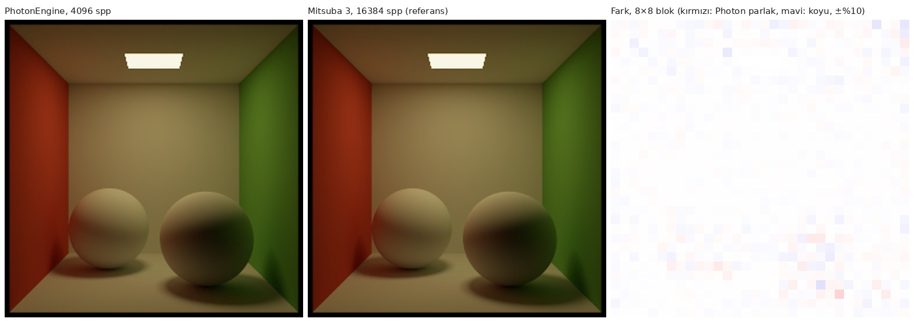
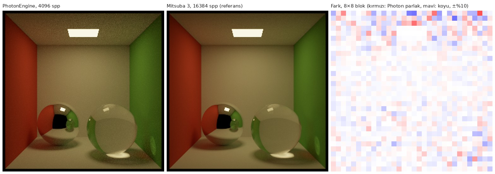
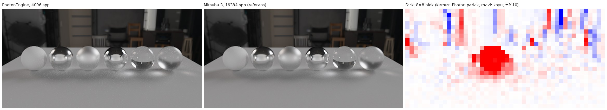

# Referans karşılaştırması: PhotonEngine, Mitsuba 3 ve Blender Cycles

Tarih 2026-11-27. Yol haritası Adım 1, "kalite kanıtı". Soru şu: PhotonEngine doğru görüntü
üretiyor mu, ve aynı sürede rakiplerinden daha temiz görüntü veriyor mu?

- **Doğruluk:** Mitsuba 3 (araştırma dünyasının referans renderer'ı) ile aynı sahne, çok yüksek
  örnekle. İki motorun da birebir ifade edebildiği modeller kullanıldı: Lambert, ideal ayna, pürüzsüz
  ve pürüzlü cam, GGX iletken, alan ışığı, HDRI.
- **Verim:** Blender Cycles (CPU, Embree, açık kaynak üretim renderer'ı) ile aynı sahne ve aynı
  iş parçacığı sayısı. KeyShot, V-Ray ve Octane kapalı kaynak; bu kapta çalıştırılamadılar.

Ortam: 4 vCPU Intel Xeon @ 2.3 GHz (AVX2), GCC 13.3 `-O3`, Embree 4.4.1, Mitsuba 3.9.1
(`llvm_ad_rgb`), Blender 5.0.1 (`bpy`). Mutlak hızlar `bench/BASELINE.md`'deki i7-6700K satırlarıyla
karşılaştırılamaz; burada önemli olan aynı makinedeki oranlardır.

## Sonuç (kısaca)

1. **Photon yansız.** Difüz Cornell kutusunda ve cam/ayna kostikli Cornell kutusunda Photon ile
   Mitsuba arasındaki fark gürültü tabanında: görüntü ortalaması %0.01 içinde, 16×16 blokların
   %95'i %0.4 içinde. Cycles da aynı ortalamayı veriyor (%0.04 içinde).
2. **HDRI aydınlatması ve malzemeler birebir.** Difüz, ayna ve cam bölgeleri Mitsuba'nın %0.1'i
   içinde (aynanın +%0.6'sı, yandaki pürüzlü metalin yansıması).
3. **Pürüzlü metal bilinçli olarak daha parlak, ve doğru olan Photon.** r = 0.5 beyaz metal
   Mitsuba'dan %12 parlak. Sebep Photon'un enerji telafisi: Kulla–Conty çoklu saçılma ve yüksekliğe
   bağlı Smith G2. Mitsuba'nın tek saçılmalı GGX'i bu enerjiyi kaybeder. Çoklu saçılmalı GGX
   kullanan Cycles ile fark yalnız **%0.3**.
4. **Cycles'tan hızlı.** Photon örnek başına 1.6–1.7× hızlı ve eşit örnekte üç sahnenin ikisinde
   daha az gürültülü. **Eşit sürede Photon'un görüntüsü 1.2–2.2× daha temiz.** Kostikli sahnede
   Cycles'ın örnek başına gürültüsü %30 daha az; Photon'un cam/kostik yollarında iyileştirme payı var.
5. **Bu çalışmada bulunan darboğaz:** Owen karıştırmalı Sobol örnekleyicisi tek iş parçacığında
   render süresinin %28'ini tutuyordu. Bit bit aynı sonucu veren hızlı sürüm ve iki küçük düzeltme
   ile 4 iş parçacığında %17–37 hızlanma geldi.
6. **Mitsuba'nın LLVM/SIMD wavefront'u bu basit sahnelerde örnek başına ~2.5× hızlı.** Photon'un
   CPU yolu skaler (yol başına bir ışın). Vektörleştirilmiş wavefront ya da GPU yolu (Adım 3),
   KeyShot ve Octane ile yarışmak için asıl kaldıraç.

## Yöntem

Sahneler `refscenes.py`'de tek tanımdan iki motora yazılır. Photon'a `.photon` projesi gider
(satır içi geometri). Mitsuba'ya PLY + sözlük sahne, Cycles'a `bpy` ile kurulan sahne gider.

| Bileşen | Photon | Mitsuba 3 | Cycles |
|---|---|---|---|
| difüz | `lambert` | `diffuse` | Diffuse BSDF |
| ışık | `lambert` + emission | `area` | Emission |
| ayna | `mirror` | `conductor`, material = none | Glossy, r = 0 |
| cam (r) | `glass` | `dielectric` / `roughdielectric`, α = r² | Glass BSDF, GGX |
| metal (r) | `disney`, metallic = 1, beyaz | `roughconductor`, α = r² | Glossy, Multiscatter GGX |
| filtre | kutu, 1 px | `box` | Box, 1 px |
| sekme | 64, Rus ruleti | `path`, max_depth 65 | tüm sınırlar 64, clamp 0, filter glossy 0 |

**Ölçüler.** *Ortalama oranı*: kanal başına görüntü ortalaması, Photon / referans. *Blok farkı*:
16×16 piksel blok ortalamalarının göreli farkı. Blok ortalaması gürültüyü bastırır, yerel sapmayı
gösterir. Gürültü tabanı, Mitsuba görüntüsünün iki yarısı (8192 + 8192 örnek) arasındaki aynı ölçüdür.
*Verim*: her motor kendi yakınsamış görüntüsüne göre ölçülür (Photon 4096, Cycles 2048 örnek), böylece
model farkları gürültüye karışmaz. Örnek başına süre (T(256) − T(16)) / 240 ile alınır; sahne kurma
ve çekirdek yükleme gibi sabit maliyetler düşer. Verim = 1 / (relMSE · süre). Büyük olan daha iyi.

Komutlar:

```bash
pip install mitsuba numpy OpenEXR pillow                     # Python 3.13
python3 bench/reference/compare.py --photon-spp 4096 --ref-spp 16384 --out bench/reference/out
python3.11 -m pip install bpy numpy OpenEXR                  # Cycles için
python3 bench/reference/efficiency.py --refdir bench/reference/out --blender-python python3.11
python3 bench/reference/make_golden.py                       # tests/data/golden/ (F2.8)
```

## 1. Doğruluk: Mitsuba 3

Photon 4096 örnek, Mitsuba 16384 örnek.

| Sahne | Ortalama oranı | Blok farkı medyan / %95 | Gürültü tabanı medyan / %95 |
|---|---|---|---|
| Cornell, difüz (256²) | 0.9999 | %0.02 / %0.07 | %0.02 / %0.09 |
| Cornell, ayna + cam, kostik (256²) | 1.0000 | %0.13 / %0.36 | %0.10 / %0.40 |
| HDRI stüdyo, 6 malzeme (384×192) | 1.0113 | %0.20 / %7.1 | %0.11 / %0.64 |





HDRI sahnesinde fark küre bölgelerine ayrılınca (merkez diskin %80'i):

| Küre | Photon / Mitsuba | Photon / Cycles | Yorum |
|---|---|---|---|
| difüz 0.8 | 1.0008 | 0.9995 | birebir |
| metal r = 0.15 | 1.0092 | 0.9985 | Kulla–Conty + G2 (küçük) ve komşu metalin yansıması |
| metal r = 0.5 | **1.1206** | **1.0030** | enerji telafisi: Mitsuba tek saçılmalı |
| ayna | 1.0059 | 1.0007 | yandaki r = 0.5 metalin yansıması |
| cam | 0.9997 | 1.0022 | birebir |
| buzlu cam r = 0.3 | 1.0007 | 0.9935 | birebir (Cycles'ta küre üçgenlenmiş) |

Arka planda (doğrudan görülen HDRI) blok farkı haritasındaki dikey çizgiler ölçüm kaynaklıdır: Mitsuba'ya
verilen harita yeniden örneklendiği için çok keskin parlak kenarlar alt-piksel kayar (aşağıya bakın).
Arka planın ortalaması %0.07 içinde.

### Karşılaştırmada çıkan iki ölçüm tuzağı

İlk turda iki küçük sapma göründü. İkisi de Photon'un değil, karşılaştırma kurulumunun hatasıydı.

- **HDRI texel kuralı (−%0.3).** Mitsuba'nın `envmap`'i texel'leri ızgara noktası sayar
  (u = i/W, v = j/(H−1)). Photon ve çoğu motor piksel merkezi kullanır. Aynı dosya Mitsuba'da dikeyde
  H/(H−1) kadar gerilir: 512 satırlık haritada toplam güç ≈ %0.2 fazla. `resample_for_mitsuba`, Photon'un
  sürekli fonksiyonunu 4× yoğun ızgarada Mitsuba'nın noktalarına örnekliyor. Bundan sonra HDRI ile
  aydınlanan zemin 1.0000.
- **Çift yüzlü ışık (+%0.2).** Photon'da Lambert ışıması iki yüzlü, Mitsuba'da tek yüzlü. Işık
  tavanın 1 mm altındayken arka yüzü delik kenarındaki tavanı sıyırarak aydınlatıyordu. Işık tavan
  düzlemine alınınca 0.9999. **Bu bir özellik eksiği:** KeyShot, V-Ray ve Cycles'ta alan ışığı tek
  yüzlü seçilebilir; Photon'da ışık yayan malzeme hep iki yüzlü (yeni görev olarak eklendi).

Doğrudan alan ışığı testi (zemin + tek dörtgen ışık, yalnız doğrudan ışık) ayrıca 1.0002 verdi.

## 2. Verim: Blender Cycles (CPU)

4 iş parçacığı, 256 örnek, her motor kendi 2048–4096 örnekli görüntüsüne göre.

| Sahne | Photon M örnek/sn | Cycles M örnek/sn | Hız (P/C) | Eşit örnekte gürültü (C/P) | **Eşit sürede verim (P/C)** |
|---|---|---|---|---|---|
| Cornell, difüz | 2.69 | 1.58 | 1.70× | 1.31× | **2.23×** |
| Cornell, kostik | 2.39 | 1.39 | 1.72× | 0.70× | **1.20×** |
| HDRI malzemeleri | 4.11 | 2.57 | 1.60× | 1.34× | **2.15×** |

Yakınsamış ortalamalar Cycles ile Photon arasında 1.0000, 0.9997 ve 1.0000. İki bağımsız üretim
tarzı motor aynı sonuca varıyor.

Kostikli sahnede Cycles'ın örnek başına gürültüsü daha düşük. İlk aday Rus ruleti politikası:
Photon 3. sekmeden sonra yalnız throughput'a bakıyor ve üst sınır koymuyor. Mitsuba ise η² düzeltmesi
ve %95 üst sınır kullanır. Path guiding (`--guiding`) bu ölçümde kapalıydı. Sıradaki iş olarak not edildi.

Bağlam: Mitsuba 3'ün `llvm_ad_rgb` çeşidi (JIT, AVX2 wavefront) aynı sahnelerde örnek başına
6.4–9.2 M örnek/sn yaptı, yani Photon'dan ~2.2–2.8× hızlı. Gürültü ölçülmedi (örnekleyici farklı).

## 3. Profil ve hızlandırma

`perf`, tek iş parçacığı, difüz Cornell. Öncesi:

| Fonksiyon | Süre payı |
|---|---|
| `SobolSampler::get2D` | **%28.5** |
| `PathTracer::Li` (kendi) | %11.9 |
| `Triangle::fillHit` | %4.5 |
| `makeShadowRay` | %4.0 |
| `Lambertian::sample` | %3.9 |

Yapılanlar:

- **Sobol örnekleyici** (`samplers/sobol_sampler.cpp`). Karıştırılmış indeks rastgele 32 bit
  olduğundan Sobol'ün 2. boyutu her çağrıda ~32 turluk, tahmin edilemez dallanmalı bir döngüydü. Artık
  bayt tablolarıyla hesaplanıyor (üreteç GF(2)'de doğrusal). İç içe düzgün karıştırmanın tanımı açılıp
  7 bit ters çevirmeden 3'e inildi, `get1D` kullanılmayan y'yi hesaplamıyor. Çıktı tanımla **bit bit
  aynı**; `SobolSampler.MatchesReferenceDefinitionBitExact` 40 000 değeri karşılaştırır. Pay %28.5'ten
  %11'e indi.
- **Lambert örneklemesi**: çerçeve üç kez kuruluyordu, artık bir kez.
- **`Image::getPixel` satır içi**: ortam haritası değerlendirmesi piksel başına dört okuma yapar.
  Ürün sahnesinde çeviri birimi dışı çağrı sürenin %7'siydi.
- **Yoğunluğu 0 olan ortam sahneye eklenmiyor**: ışık seçicinin düzgün payı NEE örneklerinin bir
  kısmını siyah haritaya harcıyordu. Ayrıca kaçan her ışın atan2/acos ödüyordu.
- `.exr` ortam haritası yüklenirken basılan sahte "HDR Load Error" kalktı.

4 iş parçacığı, M örnek/sn, iki ölçümün ortalaması (önce `main`, sonra bu dal):

| Sahne | Önce | Sonra | Fark |
|---|---|---|---|
| Cornell, difüz | 1.88 | 2.58 | +%37 |
| Cornell, kostik | 1.89 | 2.56 | +%35 |
| HDRI malzemeleri | 3.44 | 4.24 | +%23 |
| `bench/scenes/showcase.photon` (ürün vitrini) | 1.83 | 2.13 | +%17 |

Sonraki profil kalemleri (ürün sahnesi): Disney lob değerlendirmesi %8.5, gölgelendirme çerçevesi
%6.8, ortam CDF araması %4.9 ve pdf %4.3, Kulla–Conty tablo okuması %4.3. Bunlar mikro iyileştirme.
Büyük adım SIMD wavefront ya da GPU.

## 4. Regresyon koruması

`tests/test_golden_reference.cpp` (F2.8) üç sahnenin küçük kopyalarını (64², 96×48) 256 örnekle
render eder ve `tests/data/golden/*_mitsuba.exr` ile karşılaştırır (Mitsuba, 65 536 örnek). Kontrol
edilenler: kanal ortalaması ve 8×8 blok farkının medyanı ve %95'liği. HDRI sahnesinde beklenen oran
1.0155'tir; bu fark enerji telafisinden gelir. Oran 1'e düşerse telafi bozulmuş demektir, yükselirse
enerji fazlası vardır. Üç test toplam ~2 sn sürer.

## 5. Yol haritasına etkisi

- Doğruluk tarafında açık bir hata bulunmadı. Adım 2 (standartlar: OpenUSD, MaterialX/OpenPBR,
  OCIO/ACES 2) güvenle bu temelin üstüne kurulabilir.
- Yeni görevler (`memory-bank/01-gorevler.md`): tek yüzlü ışık seçeneği; cam/kostik yollarında
  Cycles'a göre fazla gürültü (Rus ruleti, guiding varsayılanı); Mitsuba'ya göre CPU verimi.
  CPU verimi için SIMD wavefront, Adım 3'teki GPU çalışmasıyla birlikte değerlendirilecek.
- KeyShot, V-Ray ve Octane ile doğrudan kıyas için lisanslı bir makinede aynı sahneler gerekiyor.
  `refscenes.py` sahneleri OBJ + HDRI olarak dışa verilebilir. Ölçüm yöntemi aynı kalır.
